# chat-demo-qt（路线 B：Qt 6 + QML + C++）

桌面 IM 多窗口 Demo 的 Qt 版，方案见 [`../ChatDemo/PLAN.md`](../ChatDemo/PLAN.md) 第 3～6、8 节。覆盖 M1～M4。
单进程、单个 `QQmlEngine`，所有窗口共享同一组 C++ 单例（对应微信 4.0 的「核心只有一份」）。

## 构建与运行

需要 Qt 6.4+（Core / Gui / Qml / Quick / QuickControls2 / Widgets / Network）和 CMake 3.21+。

```bash
cd chat-demo-qt
cmake -B build -DCMAKE_PREFIX_PATH=/path/to/Qt/6.x/macos   # 系统包安装的 Qt 可省略
cmake --build build -j
./build/bin/ChatDemo
```

| 快捷键（Qt 在 macOS 上自动把 Ctrl 映射为 ⌘） | 作用域 | 行为 |
|---|---|---|
| `Ctrl+1` / `Ctrl+2` | 主窗口 | 切换「消息」/「日历」模块（左侧导航条，持久化） |
| `Ctrl+Shift+O` | 主窗口 | 把当前会话拆到新窗口 |
| `Ctrl+Shift+M` | 独立窗口 | 合并回主窗口 |
| `Ctrl+Shift+D` | 任意窗口 | 切换浅色 / 深色主题（所有窗口同步，持久化） |
| `Ctrl+W` | 当前窗口 | 主窗口关闭右侧会话；独立窗口关闭该窗口 |
| `↩` / `⇧↩` | 输入框 | 发送 / 换行 |

拆出入口：右键「在新窗口打开」、双击会话、快捷键、拖出主窗口（新窗口落在光标处）。
关闭主窗口 = 退出 Demo（避免只剩独立窗口时布局被清掉）。

## 结构

| 文件 | 职责 |
|---|---|
| `src/chatstore.*` `src/models.*` | 会话列表模型 + 每个会话的消息模型 + 未读；收到消息时决定「计未读 / 发通知」 |
| `src/uistatestore.*` | 草稿、光标、滚动锚点、引用、未读分隔线；**写入租约**（token 不匹配直接丢弃）；草稿 JSON 持久化 |
| `src/windowmanager.*` | Placement、拆出/合并流程、单实例、输入法组合延迟、布局持久化（QSettings）、通知路由 |
| `src/mockserver.*` `src/notifier.*` | 每 3～8 秒随机推消息；`QSystemTrayIcon::showMessage`（无托盘时降级为日志） |
| `qml/ChatView.qml` | 主窗口与独立窗口共用的会话视图：挂载时恢复、变化时经租约写回 |
| `qml/Main.qml` `ConversationList.qml` `DetachedWindow.qml` | 容器与列表（拖出检测、右键菜单、快捷键） |
| `qml/Theme.qml` | 双色板单例：Light（柔和渐变底 + 紫色强调）/ Dark（深空底 + 青绿霓虹）；`WindowManager.darkMode` 持久化 |
| `qml/Card.qml` `Avatar.qml` `MacButton.qml` | 悬浮卡片（伪投影，不依赖 GraphicalEffects）、首字头像、胶囊按钮 |

## 日历模块

左侧导航条切到「日历」。交互参考 Google Calendar 与 macOS 日历，数据格式遵循 iCalendar（RFC 5545），可与两者互通。

| 能力 | 说明 |
|---|---|
| 视图 | 日 / 周（24 小时网格、重叠事件分列、当前时间红线）、月（放不下时「还有 N 项」）、年（12 个迷你月历 + 忙碌圆点）、日程（按天分组，可继续加载） |
| 活动 | 新建 / 编辑 / 删除；全天、跨天；重复（每天 / 工作日 / 每周 / 双周 / 每月按日期或第 N 个星期几 / 每年，解析任意 RRULE）；重复活动可「仅删除此次」；提醒（到点走系统通知，点击通知跳到该日期）；地点、备注 |
| 直接操作 | 周/日视图空白处**拖选时间段**新建（15 分钟吸附）；**拖动**事件改期（可跨天）；**拖底边**改结束时间；双击全天栏 / 月视图格子新建全天活动 |
| 订阅日历 | 粘贴 `https://`、`webcal://` 或本地 `.ics` 路径（Google「iCal 格式地址」、iCloud 公开日历、Outlook 发布的 ICS）；只读；按间隔自动刷新（15 分钟～每天），失败保留缓存并在侧栏显示 ⚠；右键可立即刷新 / 编辑 / 改颜色 / 取消订阅。内置一个示例订阅（含时区、RECURRENCE-ID、VALARM、VTODO） |
| 待办 | 右侧面板：今天（含逾期）/ 计划 / 全部 / 已完成四个智能列表，快速添加，截止日期 + 时间、优先级、备注；待办按截止日期显示在日/周（全天栏）、月、日程视图里，可直接勾选；订阅日历中的 VTODO 一并显示（只读） |
| 日历管理 | 本地日历新建 / 重命名 / 改颜色 / 删除 / 导出 `.ics`；勾选显示或隐藏；「仅显示此日历」 |
| 其他 | 搜索（过去 90 天～未来 1 年）、每周从周一或周日开始、显示已完成待办、所有设置持久化；导航条日历图标显示当天日期，有到期待办时带红点 |

快捷键（文本框未聚焦时，同 Google Calendar）：`T` 今天、`D/W/M/Y/A` 日/周/月/年/日程、`J/K` 或 `←/→` 翻页、`C` 新建、`/` 搜索；另有 `⌘T` `⌘N` `⌘F`。

| 文件 | 职责 |
|---|---|
| `src/ical.*` | iCalendar 解析 / 序列化（折行、转义、TZID / UTC / 浮动时间、VALUE=DATE、DURATION、EXDATE、RECURRENCE-ID、VALARM、VTODO）与 RRULE 展开（DAILY/WEEKLY/MONTHLY/YEARLY，INTERVAL、COUNT、UNTIL、BYDAY 含序号、BYMONTHDAY、BYMONTH、BYSETPOS） |
| `src/calendarstore.*` | 日历单例：日历 / 事件 / 待办的增删改查，订阅拉取（`QNetworkAccessManager`）与定时刷新，提醒检查，持久化（`<数据目录>/calendar/`：`calendars.json` + 每个日历一个 `.ics`） |
| `qml/CalendarView.qml` | 模块根：工具栏、视图切换、快捷键、弹窗 |
| `qml/TimeGridView.qml` `MonthView.qml` `YearView.qml` `AgendaView.qml` | 四类视图 |
| `qml/CalSidebar.qml` `TodoPanel.qml` | 左侧栏（创建、迷你月历、日历列表、选项）与右侧待办面板 |
| `qml/EventEditor.qml` `EventDetail.qml` `SubscribeDialog.qml` | 新建/编辑（活动 / 待办）、详情气泡、订阅对话框 |
| `qml/CalUtil.js` `MiniMonth.qml` `EventChip.qml` … | 日期工具与通用小部件 |
| `qml/NavRail.qml` | 左侧模块导航条 |

QML 与 C++ 之间日期一律用 `yyyy-MM-dd` 字符串或毫秒时间戳传递，避免 JS `Date` ↔ `QDate` 的时区偏移问题。
已知限制：编辑重复活动作用于整个系列（只有删除支持「仅此次」）；时区按本地时间展开（跨夏令时的重复事件可能差 1 小时）；暂不支持 CalDAV 双向同步与邀请/参与人。

| 周 | 月 | 日 |
|---|---|---|
| 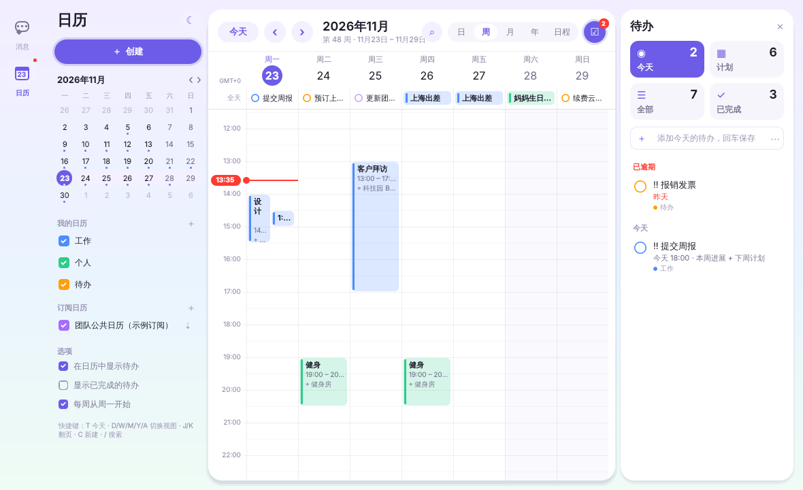 | 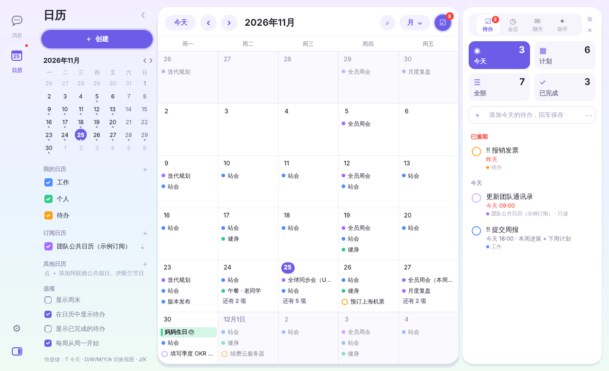 | 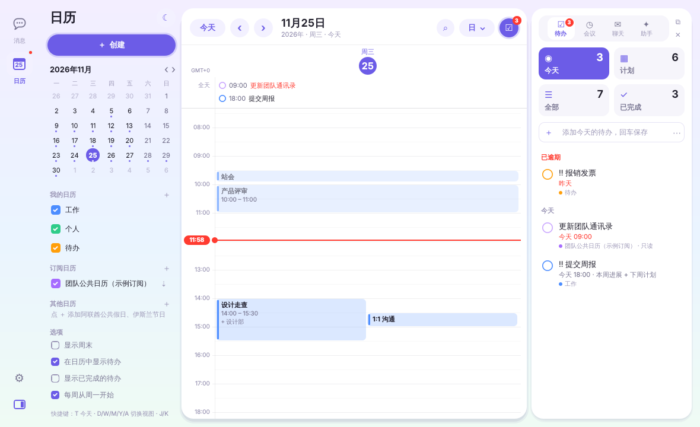 |
| 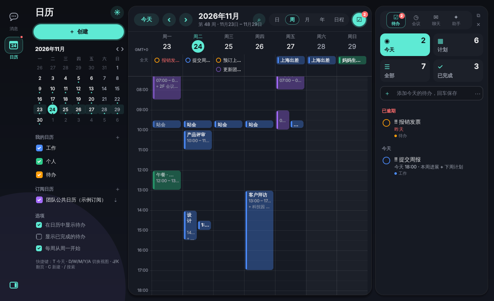 | 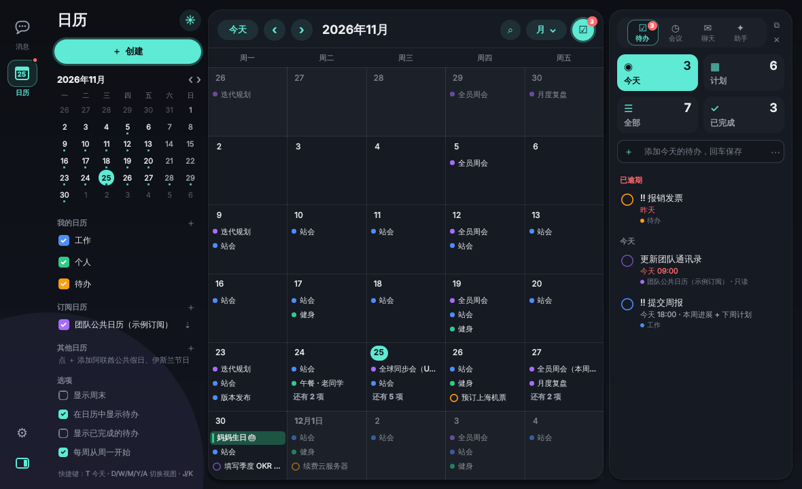 | 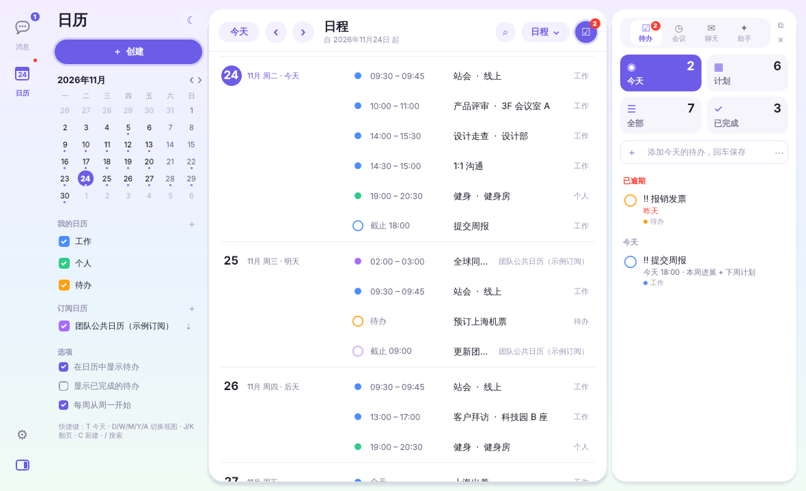 |
| **年** | **新建活动** | **订阅日历** |
| 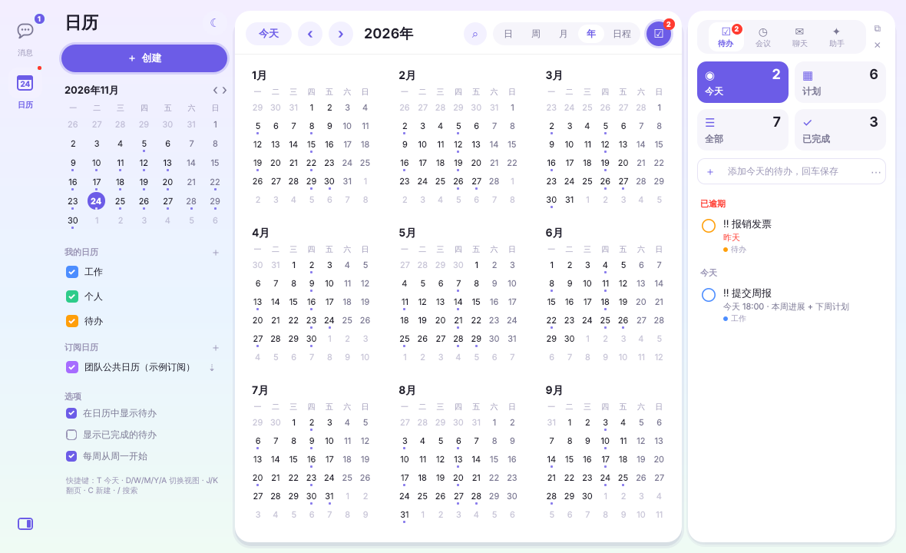 | 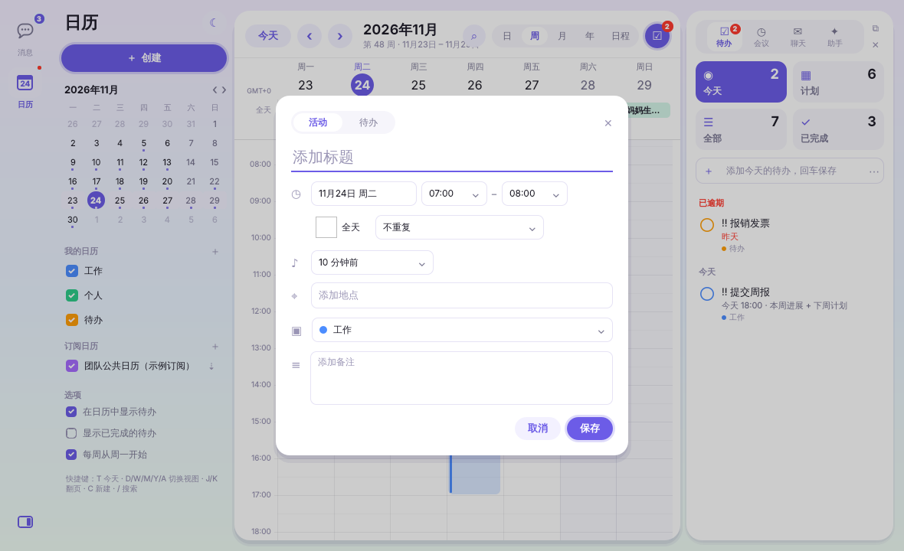 | 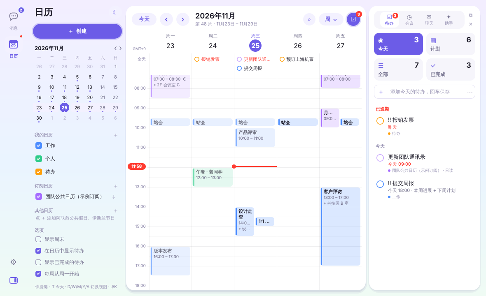 |

## 与 SwiftUI 版的差异

- **光标位置能保存**：`TextArea.cursorPosition / selectionStart / selectionEnd` 可用，验收用例 1 完整满足（SwiftUI 版做不到）。
- **单实例要自己实现**：`WindowManager` 里 `m_windows` 已有则 `raise()` + `requestActivate()`，否则创建；SwiftUI 由系统提供。
- **迁移前 flush**：`UIStateStore::flush()` 发信号，视图的 `Connections` 立即写回，再改 Placement。
- **通知点击**：`QSystemTrayIcon` 不告诉点的是哪条通知，Demo 取最近一条；正式方案需换平台原生通知 API。
- **退出**：`QEvent::Quit` 事件过滤器 + `quitApp()` 先标记「退出中」，否则窗口 closing 会把独立窗口的 Placement 清掉。

## 无头自测

`--selftest` 用真实的 QML 视图 + WindowManager 在 offscreen 平台跑一遍核心用例（共 28 项断言）：

```bash
export QT_QPA_PLATFORM=offscreen CHATDEMO_DATA_DIR=$(mktemp -d)
./build/bin/ChatDemo --selftest            # phase 1：草稿/光标迁移、输入法延迟、单实例、租约、未读+通知、合并、关闭
./build/bin/ChatDemo --selftest --phase2   # phase 2：重启后恢复独立窗口与草稿
./build/bin/ChatDemo --selftest --calendar # 日历：iCalendar 解析/往返、RRULE、增删改、订阅、提醒、五种视图（共 52 项）
```

已自动覆盖的验收用例：1、3、4、5、窗口恢复后自动滚到「新消息」分隔线（用 `setComposing` 模拟组合态）、6/9（最小化窗口的未读与通知）、10、12。
**需要真机手动验证**：用例 2（滚动锚点，离屏没有真实滚动）、7（点击通知前置窗口）、8（key 窗口可见时不通知，需要真实焦点）、11（外接屏）、真实输入法组合。
截图：`CHATDEMO_SHOT=/tmp/a` 配合 `--selftest`（或 `--selftest --calendar`）会保存截图。`CHATDEMO_MODULE=calendar` 可强制以日历模块启动。

## 截图（offscreen 自测中抓取，`--selftest` + `CHATDEMO_SHOT=路径前缀`）

| | Light | Dark |
|---|---|---|
| 主窗口 | 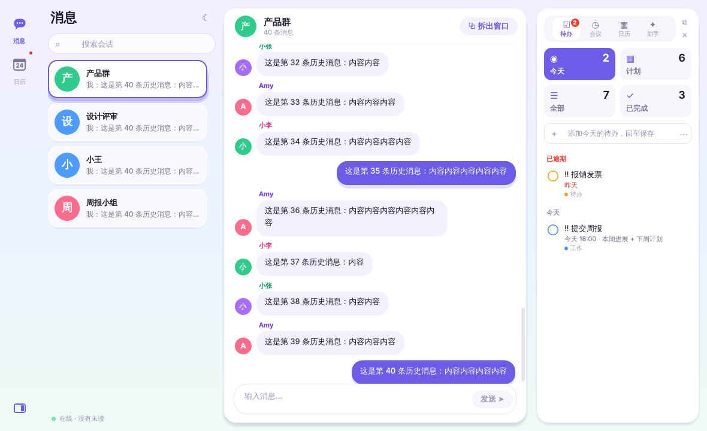 | 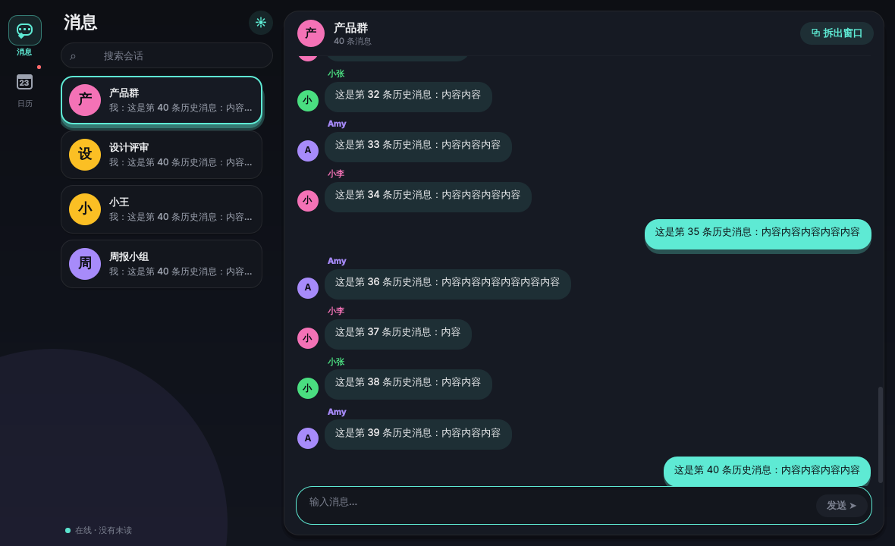 |
| 拆出后的主窗口 | 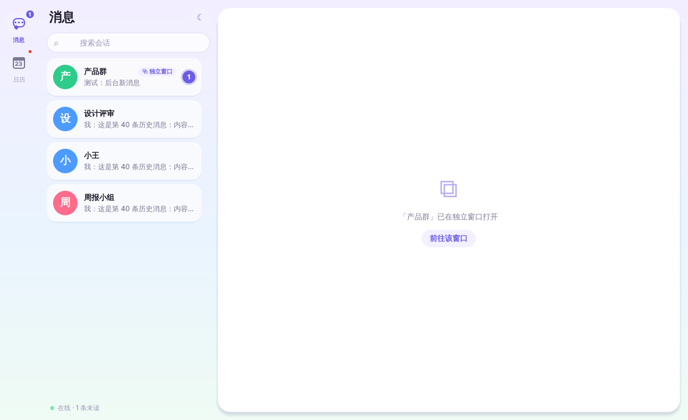 | 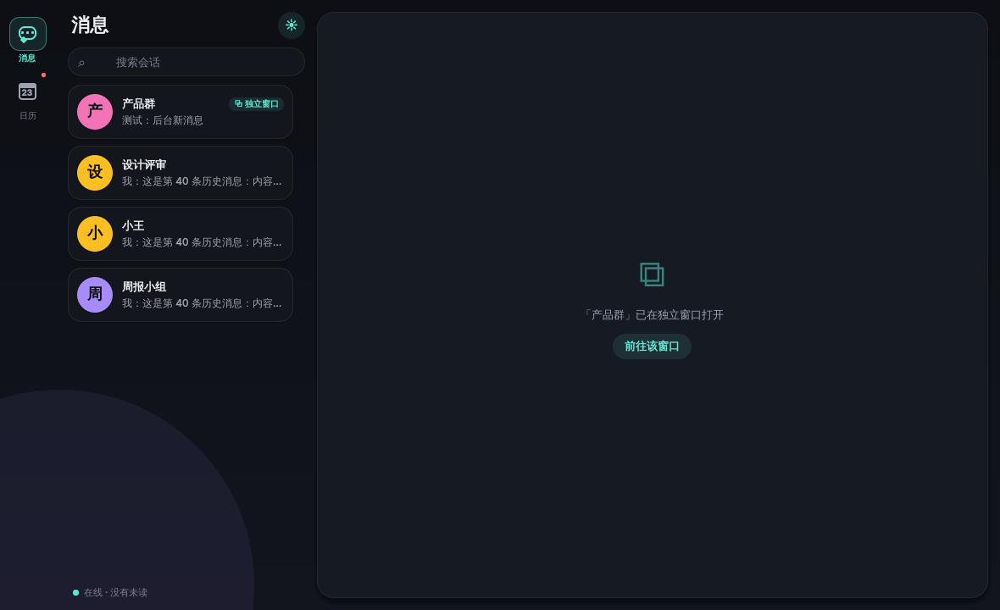 |
| 独立窗口（草稿 + 引用 + 新消息） |  | 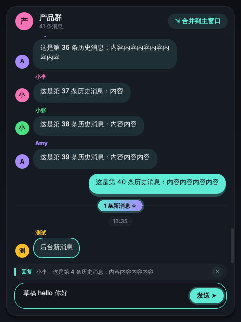 |

动效：选中会话卡片轻微漂浮、hover 上浮；未读角标数字增加时弹跳；新消息从底部上浮进入；发送按钮按下回弹；主题切换时各颜色 260ms 渐变、切换按钮旋转一圈。
`CHATDEMO_DARK=1` 可强制以深色启动（自测/截图用）。
